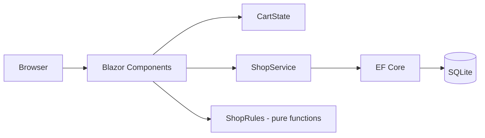

# Защита проекта EasyShop KZ (простыми словами)

**Цель:** создать небольшой интернет-магазин, в котором реально можно найти товар, положить его в корзину, оформить заказ и управлять магазином как администратор.

**Технологии:** C# и ASP.NET Core Blazor Web App на .NET 10; SQLite — хранение данных; EF Core — работа с базой данных; xUnit — тесты.

**Архитектура:** Razor Components отвечают за интерфейс. `ShopService` хранит бизнес-логику и работает с базой. `ShopDbContext` описывает таблицы. `CartState` хранит корзину в памяти Blazor и защищённом sessionStorage браузера. `ShopRules` — чистые функции без обращения к базе.

## 5-минутная демонстрация
1. Открыть главную и каталог; использовать поиск, сортировку и категории.
2. Добавить товар, изменить количество в корзине.
3. Зарегистрировать пользователя, войти и оформить заказ (Cash on Delivery).
4. Посмотреть заказ в My Orders, перезапустить приложение и показать, что запись осталась.
5. Войти администратором, создать товар, изменить цену и обновить статус заказа.

## 15 вопросов и ответов
1. **Что такое Blazor?** Фреймворк Microsoft для веб-интерфейса на C#.
2. **Зачем .NET 10?** Это целевая версия платформы проекта.
3. **Что такое EF Core?** Библиотека, через которую C# работает с базой данных.
4. **Зачем SQLite?** Легкая база данных в одном файле, без отдельного сервера.
5. **Что такое Dependency Injection?** Передача готовых сервисов компоненту вместо создания вручную.
6. **Что такое Component?** Повторно используемая часть интерфейса, например ProductCard.
7. **Что такое State?** Данные, которые интерфейс использует во время работы, например корзина.
8. **Что такое Pure Function?** Функция, которая не меняет внешние данные и при одинаковых входах дает одинаковый результат.
9. **Где FP?** `ShopRules`: расчет суммы, обновление корзины, фильтрация и проверка статуса.
10. **Что такое LINQ?** Синтаксис C# для поиска, фильтрации и группировки коллекций.
11. **Как защищен пароль?** Хранится хеш, а не открытый пароль.
12. **Как защищена админ-панель?** Авторизация по роли `Admin` на маршрутах компонентов.
13. **Почему нужно проверять склад на сервере?** Цена и количество могли измениться после добавления в корзину.
14. **Как предотвращается покупка последнего товара двумя людьми?** Условное обновление количества в транзакции.
15. **Что делает dotnet test?** Запускает автоматические тесты проверок бизнес-логики и базы данных.

## Ограничения
Корзина сохраняется после обновления и входа в той же вкладке. Закрытие вкладки завершает её сессию. Demo Card — симуляция оплаты. Выполнены автоматические проверки .NET и браузерные сценарии; точные результаты и ограничения приведены в QA_REPORT_RU.md.
